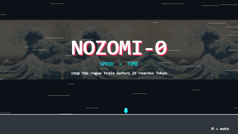
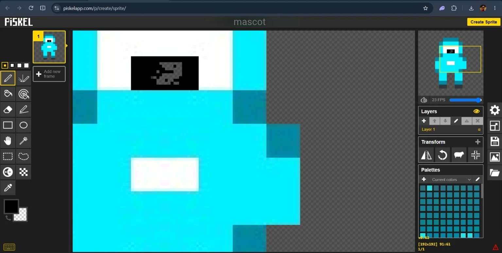

I present to you,

# **NOZOMI-0**

A rogue AI has hijacked the Shinkansen Nozomi. Race through the train and stop it before time runs out.

**Play Now:** [Nozomi-0](https://nozomi.ritammisra.com)

---

## Game Preview

---

## How to Play
* **Sprint Through 4 Train Cars:** Move fast through the Passenger Cabin, Dining Room, and Cargo Hold to reach the AI Core at the Engine Room.
* **Beat the Clock:** You have **120 seconds** before the train goes off the rails. You get +15 seconds for every Car crossed.
* **Pull the 3 Brakes:** Reach the final room and pull all **3 emergency brakes** to shut down the AI and save the train.
* **Controls:** WASD or Arrow Keys to move and jump (space can also be used), R to restart, E or J to Pull a lever and interact within the game and, SHIFT key to Dash.
---

## Artworks Used
I used some of my favorite classic artworks inside the game:
* *The Great Wave off Kanagawa* (The Great Wave)
* *A Table d'Hôte, or French Ordinary in Paris* (another fav)
* *The Starry Night* (my most favorite art piece btw)
* *Fine Wind, Clear Morning* (Red Fuji)

---

## Credits & Tools
* **Music:** "Skynet" by Karl Casey @ White Bat Audio
* **Mascot & Favicon:** Created using [Piskel](https://piskelapp.com)

---
Thanku :)